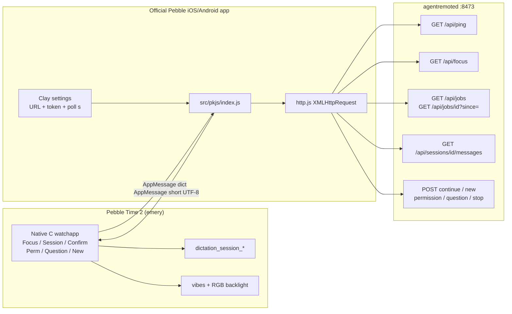
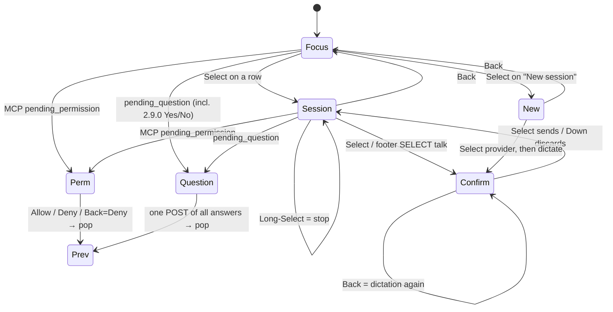
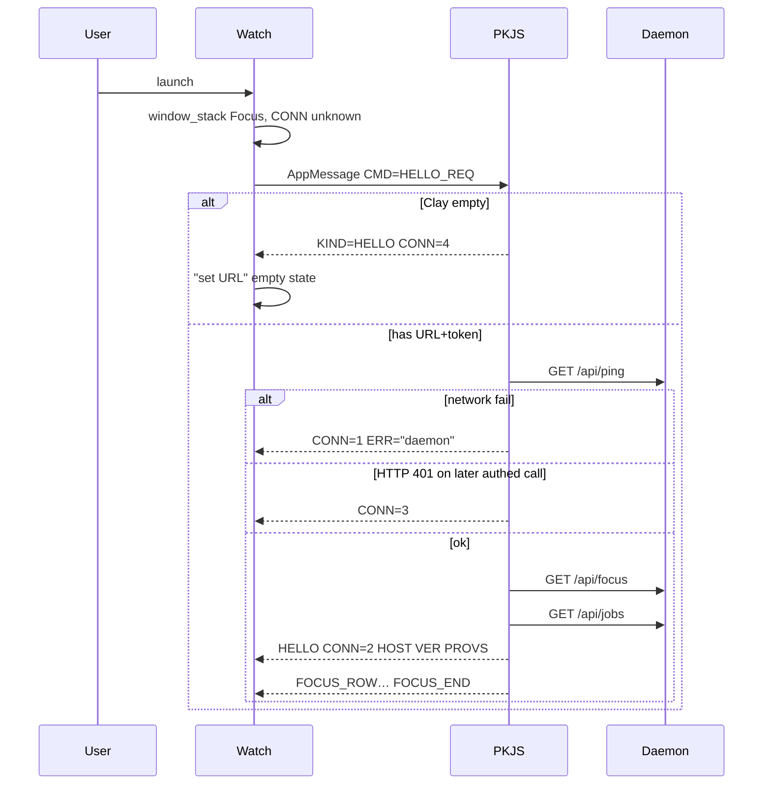
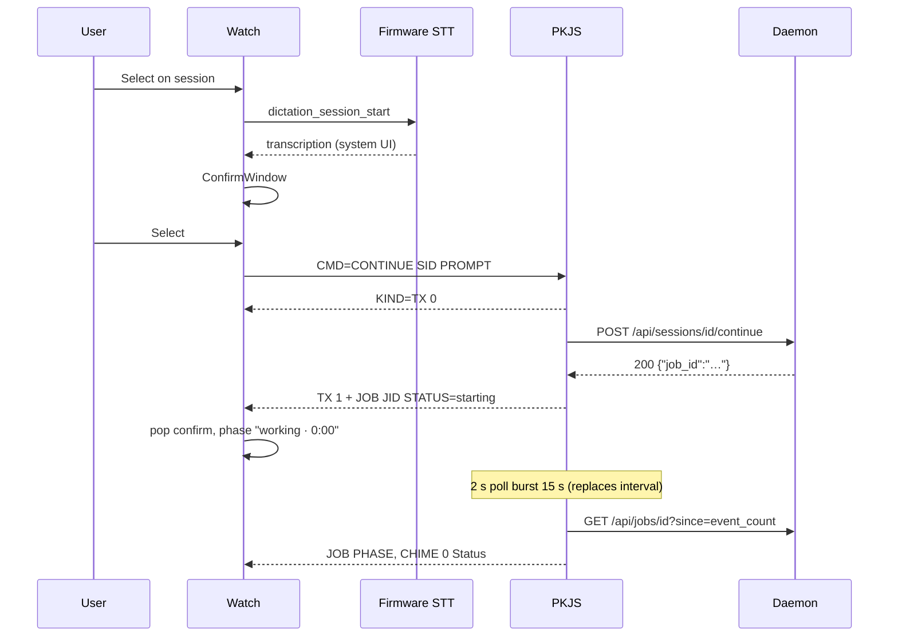
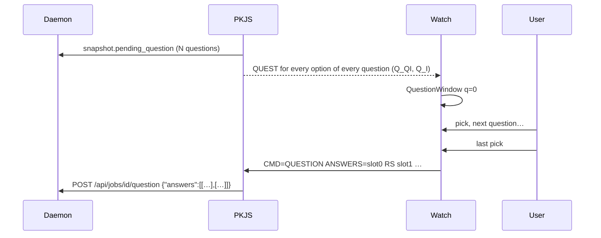
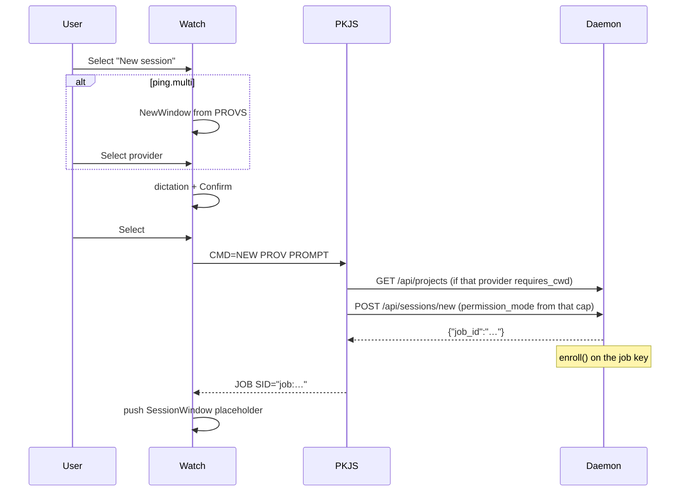
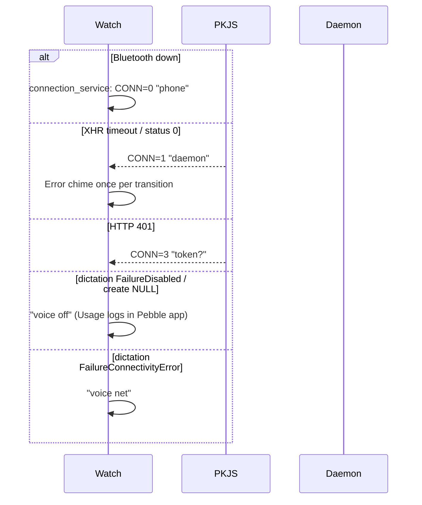

# Agent Remote — Pebble Time 2 Client

| Field | Value |
|-------|--------|
| Author | TBD |
| Date | 2026-09-09 |
| Status | Draft |
| Product | **D Pocket agent + B Talk**, one watchapp |
| Hardware | Pebble Time 2 only (`emery`, 200×228, 64-color MIP) |
| Companion | PKJS inside the official Pebble iOS/Android app + Clay |
| Workspace | `/Users/xiaowen.ji/Developer/cloud-projects/bb10-remote` |
| Related | [`pebble/design-preview/index.html`](design-preview/index.html), [`AGENTS.md`](../AGENTS.md), [`daemon/README.md`](../daemon/README.md), [`esp32/README.md`](../esp32/README.md) |

This is an implementation spec, not an options document. Product A (Pager pins), C (Desk watchface), Duo/flint, and an Android-`PebbleKit` companion are out of scope for v1.

---

## Overview

Agent Remote is a self-hosted daemon (`agentremoted` 2.9.2) plus clients (web, Android, BlackBerry 10, LILYGO T-LoRa Pager). Clients speak HTTP+JSON to one host. A Pebble Time 2 has **no Wi-Fi**: the watchapp never calls the daemon. PebbleKit JS (PKJS) in the official phone app holds the base URL and token, polls a **reshaped** slice of the existing API, and pushes short UTF-8 strings to the watch over AppMessage.

The watchapp is **one** native C app on `emery`:

- **Home** is the Focus list (D): urgency order identical to `GET /api/focus`, provider colour tick, MenuLayer-style rows, last row is **New session**.
- **Select** opens the current session (B Talk home + D’s last two plain-text messages). Footer `SELECT talk`.
- **Select** again starts `dictation_session_*`. Confirm, then `POST /api/sessions/<id>/continue`.
- Permissions and AskUserQuestion **take over** the display. Long-Select on a running session **stops**. All text input is voice.

v1 talks to **one daemon**. Provider identity is never hard-coded: `GET /api/ping` (`providers`, `multi`, `focus`, caps) is the source of truth, matching [`AGENTS.md`](../AGENTS.md).

---

## Background & Motivation

The Time 2 is the only Pebble that can do this job honestly: 200×228 64-colour MIP, four buttons, touch, mic, speaker, RGB backlight, 128 KB app RAM, ~30-day battery if we do not poll at 1 Hz. The useful wrist jobs are: notice that an agent **needs you**, Allow/Deny or pick an AskUserQuestion option, speak a prompt while walking, start a new session without a keyboard.

Closest existing constrained client is [`esp32/`](../esp32/) (Focus ranking, compose, chimes, deferred Live TUI / share / multi-profile). Closest Time 2 SDK tree already in daily use is [`../pebble-map-demo/`](../../pebble-map-demo/) (`targetPlatforms: ["emery"]`, PKJS outbox queue, `app_message_inbox_size_maximum()`, 200×228, 64-colour cube).

The locked mockups live in [`pebble/design-preview/index.html`](design-preview/index.html) sections **B Talk** and **D Pocket**. Combine them; do not ship two apps. Ignore C Desk as a product (no always-on face in v1). A-style permission action-bar chrome is reused.

Pain points this client exists to solve:

- Phone in a pocket cannot Allow a Bash prompt or answer a question without unlocking.
- The pager (`esp32/`) has a keyboard and Wi-Fi; the watch has neither — voice is the only honest composer.
- Timeline pins (product A) cannot start a turn; a Desk face (product C) cannot act.

---

## Goals & Non-Goals

### Goals (v1)

- One watchapp, `targetPlatforms: ["emery"]` only.
- PKJS companion in the official Pebble app; Clay for URL + token + optional poll seconds.
- Focus list, session (phase · elapsed · last two messages), dictation continue, permission Allow/Deny (including Claude 2.9.0 pane Yes/No on the question channel), AskUserQuestion (all questions, one POST), stop, new session (provider from ping, cwd / interactive from **that** provider’s caps), live phase while the app is **open**.
- Chimes = the same Status / Done / Error / Attention family as [`esp32/src/hw/chime.h`](../esp32/src/hw/chime.h) and [`android/.../Chime.kt`](../android/app/src/main/java/com/bb10d/remote/audio/Chime.kt), expressed as vibe patterns. RGB backlight = BB10 LED (orange held while blocked).
- Zero daemon API changes. PKJS reshapes existing JSON.

### Non-Goals (v1, documented per AGENTS.md)

| Deferred | Why |
|----------|-----|
| C Desk watchface / Timeline pins / Quick View | User declined C; no always-on face. |
| Pebble 2 Duo / flint / aplite / basalt / chalk / diorite / gabbro | Colour, mic, RAM, geometry. |
| PebbleKit inside Android Agent Remote | No `android/` companion in v1. |
| Native iOS Agent Remote companion | No `ios/` tree. |
| On-watch keyboard, Clay prompt field, phone type-a-prompt UI | All text input is voice. Clay may only collect **URL, token, and poll seconds** — never a prompt textarea, even “for debugging”. |
| Multi-host profiles | One daemon. (Pager already supports 3; watch does not.) |
| Live TUI, attachments, drop, share, rewind, usage, slash commands, queue UI | Off-watch. |
| Markdown transcript, model/cwd/effort pickers | Phone strips markdown; daemon defaults. |
| Wakeup API / background worker / 1 Hz radio | Battery. |
| `?format=watch` on the daemon | Phone-side truncation is enough. |

---

## Key Decisions

1. **Product = D + B, one app.** Home is D’s Focus list; session is B Talk chrome plus D’s two messages; new session is a list action. Not two `.pbw` files.
2. **Companion = PKJS + Clay**, not Android `PebbleKit`. Works on iOS and Android with no Agent Remote app changes. Token never leaves the phone. Clay is constructed with `{ autoAppMessage: false }`; URL, token, and poll seconds have no `messageKey` and are written only to PKJS `localStorage`.
3. **Voice is the only composer.** `dictation_session_create` / `start` / `destroy`. System confirmation **off**; our confirm screen matches mockup B. Back = speak again.
4. **Hardware = Time 2 / emery only.** `package.json` `targetPlatforms: ["emery"]`. No `#if PBL_PLATFORM` soup.
5. **Watch runtime = C (SDK 3 native), not Alloy.** See [Runtime: C, not Alloy](#runtime-c-not-alloy). PKJS is the same either way.
6. **Watch never HTTP.** PKJS uses the same endpoints and auth headers as Android [`DaemonClient.kt`](../android/app/src/main/java/com/bb10d/remote/net/DaemonClient.kt).
7. **Poll while open, sleep when closed.** 4 s working / 25 s idle. No SSE, no Wakeup, no Timeline in v1.
8. **`permission_mode` follows that provider’s `interactive` cap, never the multi root union.** Multi `/api/ping` `caps` is a union that **initializes `requires_cwd: True`** ([`server.py` ~1907–1920](../daemon/agentremoted/server.py)). **`provider_details` exists only on the multi catalogue ping** (`server.py` 1892). A single-harness process returns `{provider, caps: runner.capabilities()}` with **no** `provider_details` and typically `multi` absent/false. Lookup: `if (ping.multi && ping.provider_details) use details[name].caps; else use ping.caps` for `ping.provider`. Never use root `caps` to decide cwd or mode **on multi**. Continue/new send `"interactive"` only if **that** harness’s resolved `caps.interactive` is true (Claude, Grok, Codex-with-tmux); else `"bypassPermissions"` and no Perm/Quest UI (DeepSeek is `"interactive": False`). Omitting the field falls through to daemon `config.permission_mode` (`bypassPermissions` in [`deploy/config.example.json`](../deploy/config.example.json)) — always send one or the other. **Claude’s interactive TUI still launches with `--permission-mode bypassPermissions`** (daemon 2.9.0, [`claude_interactive._permission_panel`](../daemon/agentremoted/providers/claude_interactive.py)); pane Yes/No lands on `pending_question` with `header: "Permission"`, not on `pending_permission`. PermWindow is reserved for real MCP `/internal/permission` objects (`tool_name` / `detail`).
9. **Provider from `/api/ping`, never a build flag.** Required on `POST /api/sessions/new` when `multi: true` ([`server.py` `_route_post_multi`](../daemon/agentremoted/server.py)).
10. **CWD uses that provider’s `requires_cwd` via the same lookup as (8).** Grok on a multi host must omit cwd even when root `caps.requires_cwd` is true (`grok.py` `"requires_cwd": False`). A Grok-only daemon uses root `caps.requires_cwd === false` and also omits cwd. If the chosen provider requires cwd, PKJS takes the most recently active `GET /api/projects` row for that provider. If none, error — do not invent a path.
11. **Chimes are PKJS-owned.** PKJS diffs jobs like `esp32` `diffFeed` / `runJobEndChecks` and sends `KIND=9 CHIME`. The watch **plays that** and locally repeats Attention every 30 s while Perm/Quest is up. The watch does not infer Done/Error/Status from FOCUS/JOB (reconnect would double-buzz). Floor 2 s Status on PKJS so a dropped CHIME is not invented on the watch.
12. **Orange backlight held only while a takeover is on screen.** `light.c`: Attention = `light_set_color(GColorOrange)` + `light_enable(true)`; Status = `light_set_color(provider)` + `light_enable_interaction()` (never `enable(true)`); leave = `light_enable(false)` + `light_set_system_color()`. Working never holds the lamp.

---

## Runtime: C, not Alloy

Alloy (Moddable XS on emery/gabbro) is allowed — Time 2 only — and has `pebble/dictation`, `pebble/message`, `pebble/vibes`, `watch.light()`. We still ship **C**.

| | C native | Alloy |
|--|----------|--------|
| Author’s working emery tree | [`../pebble-map-demo/src/c/main.c`](../../pebble-map-demo/src/c/main.c) | none in-repo |
| Dictation | `dictation_session_*` (the API this spec names) | `pebble/dictation` wrapper |
| Pixel geometry (6 px stripe, 20 px bar, 30 px action bar, 42 px rows) | `Layer` + `MenuLayer` + `ActionBarLayer` | Piu/Poco, extra heap |
| App RAM 128 KB | map demo uses ~2.8 KB; we budget ~40 KB | XS slot/stack + Piu scene graph |
| Custom vibe patterns | `vibes_enqueue_custom` | `Vibes.pattern` |
| RGB backlight | `light_set_color` / `light_enable` (`PBL_RGB_BACKLIGHT`) | `watch.light()` |
| Duo later | painful either way; we are not doing Duo | emery/gabbro only |

PKJS (`src/pkjs/index.js`) is independent of the watch language. If Alloy later proves faster for UI iteration, the AppMessage dictionary in this spec stays the contract.

C window structure:

```
Window stack
  FocusWindow     MenuLayer-style list + custom status bar
  SessionWindow   stripe + title + phase + two bubbles + footer
  ConfirmWindow   transcribed text + ActionBarLayer (Select send, Down discard)
  PermWindow      takeover + ActionBarLayer (Up Allow, Down Deny)
  QuestionWindow  takeover + ActionBarLayer (Up/Down, Select)
  NewWindow       provider MenuLayer
  ErrorWindow     one-shot card (phone / 401 / daemon / dictation)
```

Dictation UI is the **system** overlay on top of ConfirmWindow’s predecessor; we disable the system confirmation dialog and push ConfirmWindow ourselves.

---

## Proposed Design

### Architecture



The watch holds **no token, no URL, no session journal**. It holds: connection enum, a Focus ring (≤12 rows of truncated fields), the open session snapshot, two message buffers, and the in-flight permission/question ids.

### Navigation



Buttons (right Up / Select / Down, left Back). Touch may pan the Focus and provider lists; it is never required. Long-Select = ~500 ms.

**Takeover rules (any screen):**

1. Before pushing Perm or Quest, call `dictation_session_stop` (discard Confirm if it is on the stack). Firmware STT and PermWindow must not overlap.
2. Push on the **current** stack. After resolve or 404, **pop** — do not force Session. A takeover that interrupted Focus returns to Focus.
3. If several jobs are blocked, take the first Focus row (`needs_answer` already sorts first). One takeover at a time.
4. MCP Perm **Back** = Deny with empty `message` (same as Down). QKIND=1 Perm chrome **Back** = the **No option’s full label** via `CMD=QUESTION` (not `cancel`, not `"No"`). Normal Quest **Back** = `cancel: true`.
5. Every exit (Allow, Deny, Back, 404, host-cleared pending) runs `takeover_leave()`: `light_enable(false); light_set_system_color();`.
6. Claude 2.9.0 pane Yes/No is a **question**, not a permission. Classify in PKJS. QKIND=1 paints Perm chrome but **always** `CMD=QUESTION` with the **verbatim option label** (see §5). Never `CMD=PERM` (that 404s `no matching pending permission`). `_answer_permission` does `picked = [l for l in answers[0] if l in labels]` and **Escape-declines** if nothing matches — `"No"` against `"No (esc)"` is a silent decline.

### Screen-by-screen layout (200×228)

All coordinates are pixels. Background `GColorBlack`, body text `GColorWhite`. Do **not** use `StatusBarLayer` (16 px); paint a **20 px** custom bar to match the mockups. Action bar is **30 px** (`ACTION_BAR_WIDTH`). Footer is **28 px**.

```
y=0        ┌──────────────────────────────────────────┐
           │ 20 px status bar  (time left, label right)│
y=20       ├──────────────────────────────────────────┤
           │ 1 px dashed separator #555               │
           │                                          │
           │ content (stripe 6 px on session screens) │
           │                                          │
y=200      ├──────────────────────────────────────────┤  ← footer on session
           │ 28 px footer                             │
y=228      └──────────────────────────────────────────┘
           x=0     x=6                          x=170  x=200
                   stripe                         action bar when present
```

#### 1. Focus list (home)

Matches D mockup (`#d` in `design-preview/index.html`), urgency order from the daemon.

| Region | Geometry | Content |
|--------|----------|---------|
| Status | 0,0 200×20 | `strftime` `%H:%M` left; `"Focus"` right. If disconnected, right label is `"phone"` / `"401"` / `"daemon"`. |
| Separator | y=20, 1 px | `#555555` dashed (2 on, 2 off) |
| Rows | y=21, each **42 px**, 1 px `#555` rule | tick 6×42; name `FONT_KEY_GOTHIC_14_BOLD` 40-byte UTF-8; subtitle `FONT_KEY_GOTHIC_14` dim |
| Highlight | selected row | fill `GColorWindsorTan` `#AA5500`; subtitle `GColorMelon` `#FFAAAA` |
| Empty | centred | `"No sessions"` in `GColorLightGray` |
| Last row | always | tick `GColorPurple` `#AA00FF`; name `"New session"`; subtitle host from ping (`host` field) or `"daemon"` |

Subtitle format: `{verb} · {Provider}`. Verbs follow the **D mockup**, not `focus_store.STATE_LABELS` (`"needs answer"` / `"turn finished"`). The pager’s `focusStateLabel()` is a third variant (`"finished"`); we stay with D.

| `focus_state` | subtitle verb | tick |
|---------------|---------------|------|
| `needs_answer` | `needs you` | provider (always; state is the text) |
| `failed` | `failed` | provider |
| `working` | live `phase` if known (`writing`, `bash`, …) else `working` | provider |
| `turn_finished` | `finished` | provider |

Tick is **always the provider cube colour**, same as D mockup. Highlight is the D tan fill, not B’s cyan.

Provider ticks (64-colour cube, locked):

| Provider (ping id) | Cube | `GColor` |
|--------------------|------|----------|
| `claude` | `#FF5500` | `GColorOrange` |
| `grok` | `#00AAFF` | `GColorVividCerulean` |
| `codex` | `#00AA55` | `GColorJaegerGreen` |
| `deepseek` / `dsh` | `#0055FF` | `GColorBlueMoon` |
| unknown | `#AAAAAA` | `GColorLightGray` |

Web/Android accents (`#d97757`, `#00d4ff`, `#10a37f`, `#4d6bfe`, Cursor `#d946ef` in [`web/src/app.js`](../web/src/app.js) `PROVIDERS`) snap to that cube. Pebble keeps four brand slots; Cursor, Copilot and unknown → dim.

Up/Down walk the highlight (B Talk “walk Focus”). Select opens the session, or New. Touch pan = same as scroll.

Cap at **12** rows plus the New row. Daemon Focus can be larger; PKJS sends the first 12 in daemon order (`needs_answer`, `failed`, `working`, `turn_finished`, then `-last_active`). Same comparator as [`server.py` `_handle_focus_list`](../daemon/agentremoted/server.py) and [`esp32/src/ui/ui.cpp`](../esp32/src/ui/ui.cpp) `weight()`.

#### 2. Session (Talk home + two messages)

Matches B home + D transcript.

| Region | Geometry | Content |
|--------|----------|---------|
| Status | 200×20 | time; right = provider label (`Grok`, …) |
| Stripe | x=0,y=20, 6×208 | provider cube colour |
| Title | x=14,y=28, w=178 | `FONT_KEY_GOTHIC_18_BOLD`, 2 lines max, 40-byte title |
| Phase | x=14,y=74 | `GColorChromeYellow` `#FFAA00`, `{phase} · {m}:{ss}` |
| Bubbles | x=8,y=96, w=184 | last **two** plain-text messages (see Transcript) |
| Footer | y=200, h=28, 1 px rule | left `{n} msgs` on the tail (`CHUNK=0`); `{n-k}/{n}` when paging older. Right **`SELECT talk`** white bold. Never `FOCUS i/n` here — that is the list. |

Bubble chrome (D):

- You: fill `#555555`, label `"You"` 12 px dim.
- Agent: fill black, 1 px provider-colour border, label = provider name.

If a permission or question is pending for this session, push takeover **on top** of this window (do not replace it). Pop returns here. `CMD=OPEN` always triggers `GET /api/jobs` (and a snapshot if `pending_*`) so a Focus row that showed `needs_answer` during an idle skip still gets `request_id` when opened.

Down: `CMD=CHUNK` with `k+1` (older pair). Up: `k-1`, clamp at 0. Back: Focus. Select: dictation. Long-Select: `POST /api/jobs/<id>/stop` if the jobs overlay has a live `JID` for this `SID`; idle Focus rows have **no** `job_id` ([`SessionDto`](../android/app/src/main/java/com/bb10d/remote/data/Models.kt) does not declare it — the daemon only overlays `job_id` / `running` in [`_apply_running`](../daemon/agentremoted/server.py) while live).

Elapsed is computed on the watch from `STARTED` (unix **int** seconds, floored from brief `started_at`). Ticked locally with `tick_timer_service` `SECOND_UNIT` **only while a job is running and this window is on top**. That is a CPU tick, not a radio tick. If the brief is gone, `STARTED=0` and the watch freezes elapsed.

#### 3. Dictation confirm

Matches B confirm (`has-ab`).

| Region | Geometry | Content |
|--------|----------|---------|
| Status | | time; `"Talk"` |
| Stripe | 6 px | provider |
| Caption | x=14,y=28 | dim `"To {title}"` |
| Body | x=8,y=48, 154×88 (action bar eats 30) | 1 px `#555` box, 14 px / 18 lh, the transcription |
| Action bar | 30×228 | Up empty; Select `✓`; Down `×` |

Select sends. Down discards and pops. Back starts `dictation_session_start` again (does not pop).

System dictation confirmation is **disabled** (`dictation_session_enable_confirmation(session, false)`) so we own this screen. Error dialogs stay **enabled** so the firmware can retry no-speech / recognizer errors.

Dictation buffer: **400 bytes** UTF-8. Longer speech is truncated by the firmware; PKJS must not clip further before POST.

If a PERM/QUEST AppMessage arrives while dictation is up: `dictation_session_stop`, pop Confirm if present, then push the takeover. The transcription is discarded.

#### 4. Permission takeover (MCP `pending_permission` only)

Matches B permission + A action-bar chrome. This window is **only** for snapshot `pending_permission` `{request_id, tool_name, detail}` — the headless `/internal/permission` helper. Interactive Claude Yes/No is a question (next section).

| Region | Geometry | Content |
|--------|----------|---------|
| Status | | time; provider |
| Stripe | `GColorOrange` | need-you, not provider |
| Tool | x=8,y=28, 18 bold | `"Allow {tool_name}?"` |
| Detail | x=8,y=56, 162× wide, 14 px dim | `detail` truncated to 120 bytes, then session title |
| Action bar | 20×20 bitmaps | Up `✓` Allow; Down `×` Deny |

RGB: Attention contract in Key Decision 12. Leave via `takeover_leave()`.

These bindings are **MCP `KIND=PERM` only**. Do not reuse them for QKIND=1 (table in §5).

- Up / Select: `CMD=PERM` → `POST /api/jobs/<id>/permission` `{request_id, allow: true}`.
- Down / Back: `CMD=PERM` `{allow: false}` empty message.
- Long-Select (hardware, after PR 5): dictation for an optional deny `message`, then `{allow: false, message}`. v1 Allow/Deny itself does **not** need the mic.

#### 5. AskUserQuestion takeover (includes 2.9.0 pane permissions)

`Job.resolve_question` clears `pending_question` on the **first** POST and wakes the TUI with whatever `answers` arrived ([`jobs.py`](../daemon/agentremoted/jobs.py)). Android [`QuestionSheet`](../android/app/src/main/java/com/bb10d/remote/ui/screens/QuestionSheet.kt) requires a pick for **every** question, then POSTs one `answers` list-of-lists. The watch does the same. **Never POST a partial `answers` array.** The pager is not a precedent (`esp32` never answers questions).

PKJS classifies the payload before sending QUEST/PERM-chrome:

**Proceed dialog** (`QKIND=1`, paint PermWindow, POST `/question`): `questions.length === 1`, `!multi_select`, `header === "Permission"` (or the question text contains `Do you want to proceed?`), and at least one option label starts with `Yes` and one with `No`. `_permission_panel` two-option fixtures are `["Yes","No"]`; three-way don’t-ask is `"Yes"` / `"Yes, and don't ask again for grep commands…"` / `"No (esc)"`. The **edit** fixture is `"Yes"` / `"Yes, allow all edits during this session"` / `"No (esc)"` — that third Yes is **not** `don't ask`.

PKJS maps candidate slots (first match, case-insensitive prefix/contains):

| Slot | Rule | Typical label |
|------|------|----------------|
| `yes_label` | first option whose label starts with `Yes` and does **not** contain `don't ask` | `Yes` |
| `no_label` | first option whose label starts with `No` | `No (esc)` or `No` |
| `always_label` | first option whose label contains `don't ask`, or empty | `Yes, and don't ask again…` |

**Coverage gate:** `QKIND=1` only when **every** snapshot option is exactly one of `{yes_label, no_label, always_label}` (empty `always_label` means 2-option Yes/No). If any option is leftover — `"Yes, allow all edits during this session"` is the usual one — send `QKIND=0` and QuestionWindow so every verbatim `QOPT` is reachable. Do not hide “allow all” behind Select=Yes. Keep the Yes/No/don’t-ask table only for true 2-option and don’t-ask 3-option panes.

Each QUEST `QOPT` is the **verbatim** snapshot `options[].label` (`_permission_panel` already caps at 60 chars). PKJS does not utf8clip further; if a label would exceed 80 bytes, treat the panel as unclassifiable and use QuestionWindow (or cancel — never POST a clipped synonym). For `QKIND=1` the watch stores the mapped strings from those `QOPT`s. `CMD` is always `QUESTION`; `ANSWERS` is the **full label**, never `"Yes"` / `"No"` unless that is the actual option text.

| Button | MCP `KIND=PERM` → `CMD=PERM` | `QKIND=1` → `CMD=QUESTION` |
|--------|------------------------------|----------------------------|
| Up | `{allow: true}` | `ANSWERS = yes_label` |
| Down | `{allow: false}` | `ANSWERS = no_label` |
| Back | `{allow: false}` | `ANSWERS = no_label` (not `cancel`) |
| Select | `{allow: true}` | `always_label` if present, else `yes_label` |
| Long-Select | deny `message` (PR 5) | unused |

If there is no don’t-ask option, Select = Yes (same as Up). `perm_win.c` must branch on `QKIND`: MCP bindings vs this table. Emitting `CMD=PERM` for QKIND=1 404s `no matching pending permission`.

**Otherwise** QuestionWindow:

| Region | Geometry | Content |
|--------|----------|---------|
| Status | | `"Ask"` plus `qIndex+1/qCount` when `questions.length > 1` |
| Stripe | `GColorRajah` `#FFAA55` | |
| Prompt | x=8,y=26, 14/18, max 2 lines | `question` (80 bytes) |
| Options | x=8, **4 visible** × 28 px = 112 px | `label` **80** bytes; selected fill `GColorRajah`. Up/Down scroll the window when `Q_N > 4`. |
| Action bar | 20×20 bitmaps | Up `▲`; Select `✓`; Down `▼` |

Geometry budget: 20 bar + 36 prompt + 112 options + 30 action-bar overlap on the right = 168, plus 8 px pad — fits 228. No sixth option on screen.

**Multi-question:** QUEST messages carry `Q_QI` (question index) and `Q_QN` (question count). The watch collects answers **sequentially** (show question 0, store pick, show question 1, …). One `CMD=QUESTION` at the end with all answers. Back on any question cancels the whole panel (`cancel: true`) — there is no “submit questions[0] and wait for a second gate”.

If `questions.length > 4`, PKJS does **not** burst a prefix and does **not** POST a short `answers` list (`resolve_question` would consume the panel). Send `KIND=8 ERR` `"open on phone"` and `CMD` is unused — PKJS itself POSTs `{cancel: true}`. Same cancel if the **watch→phone dictionary** (`CMD`+`SID`+`JID`+`RID`+`ANSWERS`+optional `QNOTE`) would exceed `AR_OUTBOX` (768). Options beyond 6 are still sent (scroll already shows 4); do not drop options of a question we intend to answer.

Single-select: Select stores the label and advances, or submits if last question.

Multi-select (`multi_select: true`): Select toggles a check; **hold Select** commits that question (advances or submits). Footer hint `"HOLD ✓"`.

If the chosen label equals `note_for`, run dictation for that question’s note **before** advancing (hardware PR 5). `notes[]` is one string per question, empty if unused, submitted with the final POST.

RGB orange held, same as permission. Leave via `takeover_leave()`.

#### 6. New session

Matches D provider list.

| Region | Geometry | Content |
|--------|----------|---------|
| Status | | `"New"` |
| Separator | y=20 | |
| Rows | 48 px | 12×12 swatch + 18 bold name |

Rows come from `ping.providers` (or `[ping.provider]` if `providers` is empty). Never hard-code the four names. If `multi: false` and a single provider, **skip this screen** and go straight to dictation.

Select → dictation for the first prompt → `POST /api/sessions/new`. Back → Focus.

### Colour / chime / backlight map

PKJS owns the diff (`poll.js`), matching `esp32` `diffFeed` + `runJobEndChecks`. The watch **only** plays `KIND=9 CHIME` plus the 30 s Attention reminder while a takeover window is up. No second source.

| Cue | When (PKJS) | `CHIME` | Vibe | Backlight (watch) |
|-----|-------------|---------|------|-------------------|
| **Status** | new job, or tool/phase change (floored 2 s on PKJS) | 0 | 18 ms pulse | `set_color(provider)` + `enable_interaction()` — never `enable(true)` |
| **Done** | job left the active set; confirmed `GET /api/jobs/<id>` status not `error` | 1 | 45 ms | system |
| **Error** | confirmed `error`, or HTTP/send failure | 2 | 55 on / 70 off / 55 on | system |
| **Attention** | `pending_permission` or `pending_question` boolean became true | 3 | 35 / 90 / 35 | **orange `enable(true)`** until `takeover_leave()` |
| *(Tick)* | tool change inside the 2 s floor | skip | skip | skip |

Haptic numbers match [`Chime.kt`](../android/app/src/main/java/com/bb10d/remote/audio/Chime.kt) `buzz()`. Speaker tones (C5–E5–G5 family) are **deferred**. Quiet Time: `vibes_enqueue_custom` already respects it.

Attention reminder: if Perm/Quest is still up after **30 s** (`kRemindMs` in `ui.cpp`), the **watch** replays Attention once per 30 s (no extra radio).

### Transcript

Phone-side only. **Pair paging — pick is this, not “one MSG per Down”:**

1. `GET /api/sessions/<id>/messages?limit=8` with **no `offset`** (daemon default = tail; [`_send_session_messages`](../daemon/agentremoted/server.py) `offset=None`).
2. Drop `role === "status"` (Grok thought/worked lines; [`MessageDto.role`](../android/app/src/main/java/com/bb10d/remote/data/Models.kt)).
3. `stripMarkdown(text)`: fences, `**`/`__`/`#` headings, `[text](url)` → `text`, collapse whitespace.
4. PKJS holds `messages[]` newest-last, length ≤ 8. Each `text` is `utf8clip(..., 180)`.
5. `CHUNK=k` (0 = tail) means: send **two** `MSG` tuples, `messages[n-2-k]` then `messages[n-1-k]` (if an index is < 0, send one). `MSG_I = k`, `MSG_N = n`, `MSG_MORE = 1` iff `k < n-2`.
6. After OPEN, PKJS sends `k=0` unsolicited. Down on the watch increments `k`; Up decrements. The watch always paints exactly the last pair it received — it does **not** store all 8.

CJK is **not** stripped (unlike [`pebble-map-demo` `toWatchText`](../../pebble-map-demo/src/pkjs/index.js)); Time 2 gothic can draw it. Truncate by **bytes**, never `string.length`.

No `?detail=steps`. No full journal on the watch.

---

## API / Interface Changes

**Daemon: none.** No version bump. No `?format=watch`. Existing payloads after phone-side truncation fit AppMessage (see sizes below). Other clients ignore us.

### HTTP surface PKJS actually calls

Auth on every call except ping-without-token. Match Android **and** the pager: send both headers ([`DaemonClient.kt`](../android/app/src/main/java/com/bb10d/remote/net/DaemonClient.kt) uses `X-Auth-Token`; [`esp32/src/net/agentapi.cpp`](../esp32/src/net/agentapi.cpp) sends both). Daemon extractor in [`server.py` `_extract_token`](../daemon/agentremoted/server.py):

```
X-Auth-Token  OR  Authorization: Bearer <token>  OR  X-Grok-Token  OR  ?token=
```

Do **not** put the token in the query string (it lands in proxy logs). Do **not** use `?token=` except as a last-resort debug.

| Method | Path | When |
|--------|------|------|
| GET | `/api/ping` | open, Clay save, reconnect. Unauthenticated for connectivity; with token for `models` we do not need. |
| GET | `/api/focus` | if `ping.focus === true` (daemon ≥ 2.6). Membership-filtered, urgency-sorted. |
| GET | `/api/sessions?limit=12` | fallback if `focus` cap is false. Rank locally with the same four-state weight. |
| GET | `/api/projects` | new session when `capsFor(provider).requires_cwd` is true. |
| GET | `/api/jobs` | overlay live ids, `started_at`, boolean `pending_*`, `event_count`. Every HELLO and OPEN; every poll tick where Focus has `working`/`needs_answer` or the last jobs list was nonempty. |
| GET | `/api/jobs/<id>?since=<n>` | doorbell. First subscribe: `since=event_count` (empty `events`, pending **objects**). Later: `since=last next_seq` for phase deltas only. **Never `since=0` after subscribe** — a long turn’s full log blows PKJS `JSON.parse`. |
| GET | `/api/sessions/<id>/messages?limit=8` | open session, then on job `done`. |
| POST | `/api/sessions/<id>/continue` | dictation send. `{prompt, permission_mode}` per [New session body](#new-session-body). 200 `{job_id}`. In-flight continue is **queued** and returns 200 of the running job ([`_handle_continue`](../daemon/agentremoted/server.py)); 409 is `"queue full"` (`_MAX_QUEUED=10`) or `"job not running"`, not “queue closed”. |
| POST | `/api/sessions/new` | first prompt. `{prompt, permission_mode, provider?, cwd?}`. 200 `{job_id}`. |
| POST | `/api/jobs/<id>/permission` | `{request_id, allow, message?}`. MCP helper path only. |
| POST | `/api/jobs/<id>/question` | `{request_id, answers:[[…] per question]}` or `{request_id, cancel:true}` plus `notes` aligned with questions. One POST for the whole panel. |
| POST | `/api/jobs/<id>/stop` | long-Select. `{}`. |

Not called in v1: `/sse/status`, `/ws/status`, `/api/jobs/<id>/queue`, `/input`, `/tui`, `/share`, `/usage`, `/drop`, `/attachments`, `/focus/<key>/done`, title, rewind.

`GET /sse/status` is what the web client uses (`EventSource` + `?token=` because EventSource cannot set headers — [`web/src/app.js`](../web/src/app.js) ~3427). PKJS *might* have EventSource, but iOS will suspend it when the watchapp closes, and a hanging GET blocks the tiny JS context. **v1 is poll-only.**

### Ping (source of truth)

Multi root (typical):

```json
{
  "ok": true,
  "app": "agentremoted",
  "version": "2.9.2",
  "host": "mac.local",
  "multi": true,
  "providers": ["claude", "grok", "codex", "deepseek"],
  "provider": "claude",
  "focus": true,
  "focus_states": ["needs_answer", "failed", "working", "turn_finished"],
  "caps": { "stop": true, "queue": true, "requires_cwd": true, "live_tui": true }
}
```

PKJS keeps `providers`, `multi`, `focus`, `host`, `version`, `caps`, and `provider_details` when present. **Caps lookup** (cwd, interactive, stop):

```javascript
function capsFor(prov) {
  if (ping.multi && ping.provider_details && ping.provider_details[prov])
    return ping.provider_details[prov].caps || {};
  return ping.caps || {}; // single-harness ping: no provider_details
}
```

Never use root `caps` to decide cwd or `permission_mode` **on multi** (union initializes `requires_cwd: True`). On a Grok-only or Claude-only daemon, `provider_details` is absent — root `caps` **is** `runner.capabilities()` and must be used. Ignore models, efforts, slash_commands, drop_path, share, chunked_upload.

Single-harness example (no `multi`, no `provider_details`):

```json
{
  "ok": true,
  "app": "agentremoted",
  "version": "2.9.2",
  "provider": "grok",
  "caps": { "requires_cwd": false, "interactive": true, "stop": true },
  "focus": true
}
```

### Focus row (already small enough)

[`FocusDto`](../android/app/src/main/java/com/bb10d/remote/data/Models.kt) / Android [`SessionDto`](../android/app/src/main/java/com/bb10d/remote/data/Models.kt): `id`, `title`, `provider`, `focus_state`, `focus_unread`, `last_text`, `last_role`, `last_active`, `cwd`. `job_id` and `running` are **not** FocusDto fields; the daemon JSON overlays them in [`_apply_running`](../daemon/agentremoted/server.py) / synthetic `job:` rows **only while live**. Idle Focus rows have no `job_id`. PERM/STOP/phase key off `GET /api/jobs`, which the doorbell already has. `last_text` is the session-screen “last line” until messages arrive.

### Job brief vs snapshot

Two shapes. Merge them on the phone; do not pretend snapshot has brief fields.

| | `GET /api/jobs` brief ([`Job.brief`](../daemon/agentremoted/jobs.py)) | `GET /api/jobs/<id>?since=` snapshot ([`Job.snapshot`](../daemon/agentremoted/jobs.py)) |
|--|--|--|
| Has | `id`, `session_id`, `new_session_id`, `status`, `started_at` (float), `provider`, `event_count`, boolean `pending_*` | `pending_*` **objects**, `next_seq`, `events[since:]`, `session_id`/`new_session_id`/`status` |
| Missing | phase, elapsed, pending objects | `started_at`, `provider`, `phase`, `elapsed_s` |

`phase` / `elapsed_s` on `/ws/status` `active[]` (`ActiveJobDto`) — v1 does not call it.

PKJS merge:

- `STARTED = Math.floor(brief.started_at)` (int seconds). If the brief is gone, `STARTED=0`; watch stops ticking.
- `elapsed` computed on the watch from `STARTED`, not from a snapshot field.
- Pending **objects**: `GET /api/jobs/<id>?since=<brief.event_count>` so `events` is empty and the payload is small. Do this when boolean `pending_*` is true and we do not yet have `request_id`.
- Phase: only from **event deltas**. Store `cursor = next_seq`. On `event_count` growth, `GET ...?since=cursor`. `kind=tool` → `name`; pending question → `asking`; pending permission → `Allow {tool}?`; else `working`.
- **Never `since=0` after the first subscribe.** A first `since=0` on a long turn returns the full event log (tool details, question payloads) and `JSON.parse` of `responseText` is the real memory limit, not the 1024-byte inbox.
- Elapsed/phase for the open session refresh from the brief + last delta every working poll — not from re-downloading events.

### New session body

```json
{
  "prompt": "<dictation>",
  "permission_mode": "interactive",
  "provider": "grok"
}
```

`provider` omitted when `multi !== true`; **required** when `multi: true` (`_route_post_multi`).

`permission_mode`: `"interactive"` iff `capsFor(prov).interactive`; else `"bypassPermissions"` (DeepSeek, Codex without tmux). On a Claude-only daemon this reads root `caps.interactive`.

`cwd`: omitted unless `capsFor(prov).requires_cwd`. When required, latest `GET /api/projects` row whose `provider` matches (or any row if untagged). Claude **400s** without cwd ([`_handle_new_session`](../daemon/agentremoted/server.py)). Grok on a multi host must **not** inherit the root union; Grok-only uses root `caps.requires_cwd === false`.

Do **not** send `model` / `effort`. The pager’s `esp32` `newSession()` always sends `bypassPermissions` — we do not, except for harnesses that cannot be interactive.

Continue uses the **session’s** provider the same way.

### Permission / question bodies (verbatim daemon contract)

```json
{"request_id": "…-p1", "allow": true}
{"request_id": "…-p1", "allow": false, "message": "optional deny note"}
{"request_id": "…-q1", "answers": [["TomTom Orbis"]]}
{"request_id": "…-q1", "answers": [["A"],["C"]], "notes": ["",""]}
{"request_id": "…-q1", "answers": [["A","C"]], "notes": [""]}
{"request_id": "…-q1", "cancel": true}
```

`answers` is **one inner list per question**, in order, same length as `questions`. `notes` is one string per question (empty if unused). 2.9.0 proceed dialogs POST `/question` with the **verbatim option label**, never `/permission`:

```json
{"request_id": "…-q1", "answers": [["Yes"]]}
{"request_id": "…-q1", "answers": [["No (esc)"]]}
{"request_id": "…-q1", "answers": [["Yes, and don't ask again for grep commands…"]]}
```

The first line is valid **only** when the snapshot option is exactly `"Yes"` (two-option `_permission_panel` fixture). Never invent `"No"` for `"No (esc)"`.

404 `no matching pending permission/question` → pop takeover, Error chime (`CHIME=2`), `takeover_leave()`. Do not force Session.

---

## Data Model Changes

None on the daemon. No migration.

Watch persistent storage (`persist_write_*`): **nothing in v1**. URL and token live in PKJS `localStorage` via Clay. A reboot of the watch just re-hellos.

PKJS `localStorage`:

| Key | Value |
|-----|--------|
| `ar.base` | normalised URL, no trailing slash (`http://10.0.0.5:8473`) |
| `ar.token` | raw token string |
| `ar.pollIdle` | seconds, default `25` |
| `ar.pollWork` | seconds, default `4` |

Never write the token to AppMessage, `console.log`, or Clay’s outbound dictionary.

---

## AppMessage dictionary

Named keys in `package.json` `pebble.messageKeys` (SDK assigns ints; C uses `MESSAGE_KEY_*`).

Open sizes (heap vs reliability):

```c
#define AR_INBOX  1024
#define AR_OUTBOX 768
app_message_open(AR_INBOX, AR_OUTBOX);
```

Do **not** call `app_message_inbox_size_maximum()` (the map demo does, because it streams a binary map). 1024+768 ≈ 1.8 KB of the 128 KB heap; plenty for UI. Dictionary overhead is ~7 bytes/tuple + 1-byte type + payload.

PKJS outbox is a queue inspired by [`pebble-map-demo/src/pkjs/index.js`](../../pebble-map-demo/src/pkjs/index.js) `outbox[]` / `kickOutbox()` — one in-flight `Pebble.sendAppMessage`. Deltas from the demo:

- **Retry once on NACK**, then drop that message and continue (the demo does not retry).
- **Generation cap:** each poll that produces Focus rows bumps `FOCUS_GEN`. A queued `FOCUS_ROW`/`FOCUS_END` with an older gen is dropped when a newer gen is enqueued. At most one generation in the queue.
- **Coalesce HTTP:** at most one poll XHR in flight. If the 4 s timer fires while a request is open, skip and reschedule. Burst 2 s / 15 s after CONTINUE **replaces** the interval (clear, then set); it does not stack a second timer.
- Closing the watchapp **kills the PKJS context**; there is no `ready` teardown. `ready` is start. Timers die with the context.

### Watch → phone (`CMD` discriminator)

`CMD` is `int32`. Optional fields ignored if absent.

| Key | Type | Max | Meaning |
|-----|------|-----|---------|
| `CMD` | int | | `1` HELLO_REQ, `2` POLL_NOW, `3` OPEN, `4` CONTINUE, `5` NEW, `6` PERM, `7` QUESTION, `8` STOP, `9` CHUNK, `10` PROVIDERS_REQ |
| `SID` | cstring | 64 | session id (UUID or `job:<id>`) |
| `JID` | cstring | 48 | job id |
| `RID` | cstring | 48 | `request_id` |
| `PROMPT` | cstring | 400 | dictation text (CONTINUE / NEW / deny note / question note) |
| `PROV` | cstring | 16 | `claude` / `grok` / `codex` / `deepseek` |
| `ALLOW` | int | | 1 allow / 0 deny (CMD=PERM only) |
| `CANCEL` | int | | 1 → question cancel |
| `ANSWERS` | cstring | 400 | **never JSON.** Packing rule below. 4×80 + `\x1e` is 323 B. |
| `CHUNK` | int | | pair offset `k`; 0 = newest pair |
| `QNOTE` | cstring | 200 | `notes` packed with `\x1e` between questions. **Omit the tuple** when every note is empty (an empty 200 B field plus `ANSWERS` 400 plus ids is ~817 B > 768). Sent only on the final QUESTION after every question is collected. |

**Outbox fit (cancel, do not clip):** C packs `CMD`+`SID`+`JID`+`RID` (~199 B) + `ANSWERS` + `QNOTE` only if any note is nonempty. Dictionary overhead ~8 B/tuple. If the encoded dict would exceed `AR_OUTBOX` 768, the watch sends `CANCEL=1` with no `ANSWERS`/`QNOTE` (or PKJS POSTs `{cancel: true}` and `ERR` `"open on phone"`). Never drop a question slot to shrink the payload. The 4×80 design point plus a 200 B note still fits (~740 B); the 400 B `ANSWERS` cap alone does not.

**ANSWERS packing (one rule):** C never sends JSON. Labels can contain commas (`Yes, and don't ask again…`).

- Single question, single-select: the label string.
- Single question, multi-select: labels joined with `\x1f` (unit separator), **never comma**.
- Several questions: slots joined with `\x1e` (record separator); each slot uses `\x1f` if that question was multi-select.

PKJS always wraps to `answers: [[...], ...]`: split `\x1e` then `\x1f`. Never `JSON.parse` the raw label.

HELLO_REQ is sent from `app_ready` and whenever Bluetooth reconnects (`connection_service_subscribe`).

### Phone → watch

Keep each **message** under ~900 bytes so it fits `AR_INBOX` with overhead.

| Key | Type | Max | Meaning |
|-----|------|-----|---------|
| `KIND` | int | | `1` HELLO, `2` FOCUS_ROW, `3` FOCUS_END, `4` SESS, `5` MSG, `6` PERM, `7` QUEST, `8` ERR, `9` CHIME, `10` TX, `11` JOB |
| `CONN` | int | | `0` no phone (watch-local), `1` no daemon, `2` ok, `3` 401, `4` clay missing |
| `HOST` | cstring | 24 | ping `host` |
| `VER` | cstring | 12 | ping `version` |
| `MULTI` | int | | 0/1 |
| `PROVS` | cstring | 64 | `"claude,grok,codex,deepseek"` |
| `FOCUS_N` | int | | total rows (≤12) |
| `FOCUS_I` | int | | row index |
| `FOCUS_GEN` | int | | poll generation; stale outbox rows with older gen are dropped |
| `SID` | cstring | 64 | |
| `TITLE` | cstring | 40 | |
| `STATE` | cstring | 16 | `needs_answer` / `failed` / `working` / `turn_finished` |
| `PROV` | cstring | 16 | |
| `PHASE` | cstring | 24 | `writing`, `asking`, `bash`, … |
| `ELAPSED` | int | | seconds |
| `STARTED` | int | | unix seconds, 0 if idle |
| `LAST` | cstring | 96 | last_text / last assistant line |
| `JID` | cstring | 48 | |
| `STATUS` | cstring | 12 | `starting`/`running`/`done`/`error`/`stopped` |
| `UNREAD` | int | | `focus_unread` |
| `MSG_I` | int | | chunk index |
| `MSG_N` | int | | total plain messages PKJS holds (≤8) |
| `MSG_ROLE` | int | | `0` user `1` assistant |
| `MSG_TEXT` | cstring | 180 | |
| `MSG_MORE` | int | | 1 if older exists |
| `RID` | cstring | 48 | |
| `TOOL` | cstring | 24 | `Bash`, … |
| `DETAIL` | cstring | 120 | permission detail |
| `QTEXT` | cstring | 80 | |
| `QOPT` | cstring | 80 | one option per QUEST message (80 so 2.9.0 “don’t ask again…” stays distinct) |
| `Q_I` / `Q_N` | int | | option index / count among **this** question |
| `Q_QI` / `Q_QN` | int | | question index / count in the panel (1-based display, 0-based wire) |
| `QMULTI` | int | | 0/1 for this question |
| `QNOTEFOR` | cstring | 40 | `note_for` label or empty |
| `QKIND` | int | | `0` normal Ask; `1` proceed dialog (PermWindow chrome, still QUEST) |
| `ERR` | cstring | 48 | user-visible error |
| `CHIME` | int | | `0` Status `1` Done `2` Error `3` Attention |
| `TX` | int | | `0` sending `1` accepted `2` failed |

**HELLO** (`KIND=1`): `CONN`, `HOST`, `VER`, `MULTI`, `PROVS`. Watch may then `CMD=10` if it needs the provider list for New (or parse `PROVS`). `CONN=2` only after ping succeeded.

**FOCUS_ROW** diffs, then **FOCUS_END**: PKJS diffs by `SID`. Send only changed rows plus `FOCUS_END` with `FOCUS_N` and `FOCUS_GEN`. If the set shrinks, still send END so the watch drops the tail. Full refresh only when gen 0 (first paint) or SID set membership changes by more than half.

**SESS**: snapshot for the open session (title, phase, `STARTED`, last, jid, status). `STARTED` from the **brief**, not the snapshot.

**MSG**: always a **pair**. After OPEN, two MSG with `MSG_I=0`. Each `CMD=CHUNK` `k` is answered with two MSG (`messages[n-2-k]`, `messages[n-1-k]`). `MSG_MORE=1` iff older pairs exist (`k < n-2`).

**PERM**: MCP `pending_permission` object.

**QUEST**: one message per option of **one** question (`Q_I`/`Q_N`) plus `QTEXT` on `Q_I=0`, plus `Q_QI`/`Q_QN`. `QKIND=1` means proceed-dialog chrome; `QOPT` is the verbatim snapshot label. **Burst:** send every option of every question up front when `questions.length ≤ 4` (options of one question are all sent, even if `> 6`; scroll shows 4). If `questions.length > 4`, do **not** burst a prefix: PKJS POSTs `{cancel: true}` and sends `ERR` `"open on phone"`. Watch pages questions locally and POSTs once. Do not stream questions one POST at a time. Do not POST a short `answers` list.

**JOB**: doorbell overlay (`SID`, `JID`, `PHASE`, `STARTED`, `STATUS`) without rewriting the whole Focus list. `ELAPSED` is optional; the watch prefers `now - STARTED`.

**CHIME**: the only chime source. Watch plays it; does not infer.

**ERR**: `KIND=8` + `ERR` text; watch pushes `ErrorWindow`.

String truncation helper (PKJS). After a surrogate `i++`, `slice(0, i+1)` includes the trail — cover this with a test (emoji + CJK):

```javascript
function utf8clip(s, max) {
  s = String(s || '');
  var out = '', i, c, n = 0;
  for (i = 0; i < s.length; i++) {
    c = s.charCodeAt(i);
    n += c < 0x80 ? 1 : c < 0x800 ? 2 : (c >= 0xd800 && c <= 0xdbff) ? 4 : 3;
    if (c >= 0xd800 && c <= 0xdbff) i++; // skip trail surrogate
    if (n > max) break;
    out = s.slice(0, i + 1);
  }
  return out;
}
```

---

## Poll strategy (honest)

```mermaid
sequenceDiagram
  participant W as Watch C
  participant P as PKJS
  participant D as agentremoted
  W->>P: CMD HELLO_REQ
  P->>D: GET /api/ping
  P->>D: GET /api/focus
  P->>D: GET /api/jobs
  P-->>W: HELLO CONN=2
  P-->>W: FOCUS_ROW × N + FOCUS_END
  loop while watchapp in foreground
    Note over P: 4s if jobs live OR Focus has<br/>working/needs_answer; else 25s
    P->>D: GET /api/focus
    opt live Focus or last jobs nonempty or OPEN/HELLO
      P->>D: GET /api/jobs
    end
    opt pending_* true and no request_id yet
      P->>D: GET /api/jobs/id?since=event_count
    end
    opt event_count grew
      P->>D: GET /api/jobs/id?since=cursor
    end
    P-->>W: FOCUS_ROW diffs + FOCUS_END(GEN), JOB, PERM/QUEST, CHIME
  end
  Note over P: watchapp close kills PKJS context<br/>no SSE, no Wakeup, no pins
```

| App state | Radio |
|-----------|--------|
| Watchapp foreground, live | **4 s** (`ar.pollWork`) focus **and** jobs whenever **either** the last jobs list has `starting`/`running`/`pending_*` **or** any Focus row is `working` / `needs_answer`. Snapshot: `since=event_count` for pending objects; `since=cursor` for phase deltas. Never `since=0` after subscribe. |
| Watchapp foreground, idle | **25 s** (`ar.pollIdle`) focus. Skip `GET /api/jobs` **only** when Focus has **no** `working`/`needs_answer` rows **and** the last jobs list was empty. A Focus `needs_answer` while jobs was empty (turn blocked after the last idle tick) **must** GET jobs on that tick so `request_id` arrives and takeover can fire. |
| `CMD=HELLO_REQ` / `CMD=OPEN` | **Always** `GET /api/jobs` (and snapshot if `pending_*`), even if the previous tick skipped jobs. OPEN loads messages **and** the job snapshot — not messages alone. |
| After CONTINUE/NEW (15 s) | **2 s** burst **replaces** the interval (one timer) |
| Permission/question showing | **4 s** (catch timeout/host-answered-in-TUI) |
| Watchapp closed | **zero**. Closing the watchapp kills PKJS; timers die with the context. `ready` is start, not stop. |
| Phone app killed | zero. Watch shows `CONN` timeout after 20 s without HELLO/FOCUS. |
| HTTP in flight | skip this tick; reschedule. At most one XHR. |

Clay slider range: work 3–8 s, idle 15–45 s. Refuse 1 Hz.

**Wakeup API: deferred.** `wakeup_schedule` could open the app on a timer, but without a reliable PKJS background fetch the watch would open to stale data and then poll — that is a Desk-face substitute the user declined. Revisit only if we later ship C or an Android companion that can push.

**SSE while open:** deferred. If PKJS EventSource proves stable on both iOS and Android in a spike, it can replace the 4 s jobs poll; the watch contract does not change.

---

## Sequence diagrams

### Open app



### Dictate and send (continue)



### Permission (MCP) vs 2.9.0 pane Yes/No

```mermaid
sequenceDiagram
  participant D as Daemon TUI
  participant P as PKJS
  participant W as Watch
  participant U as User
  D->>D: Claude pane Yes/No → pending_question header=Permission
  P->>D: GET /api/jobs (pending_question true)
  P->>D: GET /api/jobs/id?since=event_count
  D-->>P: snapshot.pending_question
  P->>P: classify proceed dialog
  P-->>W: KIND=QUEST QKIND=1 + CHIME 3
  W->>W: dictation_session_stop if any; push Perm chrome; orange held
  U->>W: Down (no_label)
  W->>P: CMD=QUESTION ANSWERS=No (esc)
  P->>D: POST /api/jobs/id/question {"answers":[["No (esc)"]]}
  D-->>P: {"ok": true}
  P-->>W: KIND=JOB pending cleared
  W->>W: pop previous window; takeover_leave()
```

The `ANSWERS` value is the **QOPT string** for that button, e.g. `"Yes"`, `"No (esc)"`, `"Yes, and don't ask again for grep commands…"`. Real MCP `pending_permission` uses `KIND=PERM` and `POST .../permission`. QKIND=1 must not emit `CMD=PERM`. Back = `no_label`.

### AskUserQuestion



### New session



### Disconnect / error



---

## PKJS module map

```
pebble/
  package.json              targetPlatforms: ["emery"], capabilities: ["configurable"]
  wscript                   stock SDK
  src/pkjs/
    index.js                ready / appmessage / showConfiguration; outbox queue
    clay.js                 Clay constructor + config.json
    config.js               Clay JSON (URL, token, poll sliders)
    http.js                 xhr(method, path, body, cb) — ES5 callbacks
    reshape.js              ping/focus/jobs/messages → AppMessage fields
    poll.js                 one timer, one XHR, doorbell cursor, chime diff; GET jobs on Focus working/needs_answer and on OPEN/HELLO
    mdstrip.js              stripMarkdown
```

Tests (Node, no pebble-tool): `pebble/test/reshape_test.js` — `utf8clip` (BMP, CJK, surrogate emoji), `stripMarkdown`, Focus rank fallback, ANSWERS split, `capsFor` (multi details vs single root `caps`), proceed-dialog classifier (verbatim `"No (esc)"` / don’t-ask; **edit “allow all” leftover → QKIND=0**; never bare `"No"`). Outbox-size helper: omit empty `QNOTE`; cancel when dict > 768.

PKJS is callback-style ES5, matching [`pebble-map-demo/src/pkjs/index.js`](../../pebble-map-demo/src/pkjs/index.js). Do not rely on `Promise` or `XHR.timeout` until PR1 spikes them on the official Pebble iOS/Android app; implement timeout with `setTimeout` + `abort()`. A 15-line Promise polyfill is allowed internally but `http.js`’s public API is `xhr(..., cb)`.

`index.js` responsibilities:

```javascript
Pebble.addEventListener('ready', function () {
  loadLocal();  // ar.base / ar.token / poll from localStorage
  // CONN=4 if missing creds; otherwise leave CONN unknown until ping returns.
  // Do not send CONN=2 here — that flashes Focus while the daemon is down.
  if (!hasCreds()) {
    queueMsg({KIND: 1, CONN: 4});
    return;
  }
  queueMsg({KIND: 1, CONN: 1}); // "daemon" until ping lands
  startPoll();
});
Pebble.addEventListener('appmessage', function (e) {
  handleCmd(e.payload);
});
Pebble.addEventListener('showConfiguration', function () {
  Pebble.openURL(clay.generateUrl());
});
Pebble.addEventListener('webviewclosed', function (e) {
  // Parse JSON ourselves. Never clay.getSettings() → sendAppMessage.
  // Write ar.base / ar.token / poll to localStorage only; then ping.
});
```

Clay constructor **must** disable auto-send (token, URL, and poll sliders all stay off the watch):

```javascript
var clay = new Clay(config, null, { autoAppMessage: false });
```

`http.js` (callbacks, abort timeout, JSON content-type):

```javascript
function xhr(method, path, jsonBody, cb) {
  var x = new XMLHttpRequest();
  var url = base.replace(/\/$/, '') + path;
  var t;
  x.open(method, url, true);
  x.setRequestHeader('Accept', 'application/json');
  x.setRequestHeader('Content-Type', 'application/json');
  if (token) {
    x.setRequestHeader('X-Auth-Token', token);
    x.setRequestHeader('Authorization', 'Bearer ' + token);
  }
  x.onreadystatechange = function () {
    if (x.readyState !== 4) return;
    clearTimeout(t);
    if (x.status === 401) return cb({status: 401, error: 'token'});
    if (x.status < 200 || x.status >= 300) return cb({status: x.status, error: x.responseText});
    try { cb(null, JSON.parse(x.responseText || '{}')); }
    catch (e) { cb({status: x.status, error: 'bad json'}); }
  };
  x.onerror = function () { clearTimeout(t); cb({status: 0, error: 'daemon'}); };
  t = setTimeout(function () { try { x.abort(); } catch (e) {} cb({status: 0, error: 'daemon'}); },
                 path.indexOf('/ping') >= 0 ? 8000 : 15000);
  x.send(jsonBody ? JSON.stringify(jsonBody) : null);
}
```

Clay `config.js` (fields only; styling is Clay default). **Clay may only collect URL, token, poll seconds.**

- heading `Agent Remote`
- `input` `daemon_url` — label “Daemon URL (LAN IP of the host, not 127.0.0.1)”. **Default empty.** Placeholder `http://192.168.x.x:8473`. Saving the empty default keeps CONN=4 `setup`. `127.0.0.1` in PKJS is the **phone**, not the Mac running the daemon (Android uses 8473 only as `DEFAULT_PORT`, never a loopback URL).
- `input` `token` — label “Token” (from `~/.agentremoted/token`). **No `messageKey`.**
- `slider` `poll_work` 3–8, default 4, label “Poll while working (s)” — **no `messageKey`**
- `slider` `poll_idle` 15–45, default 25, label “Poll while idle (s)” — **no `messageKey`**
- `text` “The watch never stores the token. One daemon in v1. Use the host’s LAN / Tailscale IP, not 127.0.0.1.”

Normalise URL like Android `DaemonClient.normalize`: trim, strip trailing `/`, prepend `http://` if no scheme. Port hint 8473, not a default host.

---

## Watch module map

```
pebble/
  package.json
  src/c/
    main.c           init, window stack, connection_service, tick_timer
    app.h            shared structs (FocusRow, SessSnap, Conn)
    palette.h        GColor* mapping
    msg.c / msg.h    inbox/outbox, utf8 copy into fixed buffers
    poll_ui.c        apply FOCUS_ROW / JOB / PERM / QUEST; play CHIME
    chime.c          vibes_enqueue_custom from CHIME; 30 s Attention reminder
    light.c          Attention = orange+enable(true); Status = provider+enable_interaction(); leave = enable(false)+set_system_color()
    dictation.c      session create/start/stop; 400-byte buffer
    focus_win.c      list layer
    sess_win.c       stripe, title, phase, bubbles, footer
    confirm_win.c    ActionBarLayer
    perm_win.c       MCP permission + proceed-dialog chrome
    quest_win.c      AskUserQuestion, 4 visible options, multi-question collect
    new_win.c
    error_win.c      CONN / dictation / HTTP cards
  resources/images/menuicon.png     25×25, menuIcon true
  resources/images/ab_check.png     20×20 ActionBarLayer
  resources/images/ab_cross.png     20×20
  resources/images/ab_up.png        20×20
  resources/images/ab_down.png      20×20
  test/reshape_test.js              Node fixtures for clip/strip/rank/ANSWERS
```

`package.json` (scaffold):

```json
{
  "name": "agent-remote",
  "author": "Agent Remote",
  "version": "0.1.0",
  "keywords": ["pebble-app"],
  "private": true,
  "dependencies": {
    "@rebble/clay": "^1.0.4"
  },
  "pebble": {
    "displayName": "Agent Remote",
    "uuid": "a8473e12-7e2b-4b10-9e2e-c0de0000bb10",
    "sdkVersion": "3",
    "enableMultiJS": true,
    "projectType": "native",
    "capabilities": ["configurable"],
    "targetPlatforms": ["emery"],
    "watchapp": { "watchface": false },
    "messageKeys": [
      "CMD","SID","JID","RID","PROMPT","PROV","ALLOW","CANCEL","ANSWERS","CHUNK","QNOTE",
      "KIND","CONN","HOST","VER","MULTI","PROVS",
      "FOCUS_N","FOCUS_I","FOCUS_GEN","TITLE","STATE","PHASE","ELAPSED","STARTED","LAST","UNREAD","STATUS",
      "MSG_I","MSG_N","MSG_ROLE","MSG_TEXT","MSG_MORE",
      "TOOL","DETAIL","QTEXT","QOPT","Q_I","Q_N","Q_QI","Q_QN","QMULTI","QNOTEFOR","QKIND",
      "ERR","CHIME","TX"
    ],
    "resources": {
      "media": [
        { "file": "images/menuicon.png", "menuIcon": true, "name": "IMAGE_MENU_ICON", "type": "bitmap" },
        { "file": "images/ab_check.png", "name": "IMAGE_AB_CHECK", "type": "bitmap" },
        { "file": "images/ab_cross.png", "name": "IMAGE_AB_CROSS", "type": "bitmap" },
        { "file": "images/ab_up.png", "name": "IMAGE_AB_UP", "type": "bitmap" },
        { "file": "images/ab_down.png", "name": "IMAGE_AB_DOWN", "type": "bitmap" }
      ]
    }
  }
}
```

Generate a fresh UUID at PR1 if this one collides on the Rebble store; freeze it after first sideload.

Menu icon: 25×25 PNG, Agent Remote mark (chevron + bar, same geometry as the web SVG in [`web/src/app.js`](../web/src/app.js) ~1035) snapped to the cube: chevron `GColorOrange`, bar `GColorVividCerulean`, black background.

Fonts: system `FONT_KEY_GOTHIC_14`, `_14_BOLD`, `_18_BOLD` only. No custom TTF in v1 (CJK subset would blow the pbw).

Heap budget (emery 128 KB app RAM):

| Item | Budget |
|------|--------|
| AppMessage inbox+outbox | 1.8 KB |
| Dictation buffer | 0.4 KB |
| 12 Focus rows × ~80 B | 1 KB |
| 8 message chunks × 180 B | 1.5 KB |
| Windows / layers / action bar | ~20 KB |
| Code + static | ~40 KB |
| Slack | rest |

---

## Error states

| Condition | Watch | Chime |
|-----------|-------|-------|
| Bluetooth down | status right `"phone"`; list frozen | none on every redraw; Error once on edge |
| Clay missing URL/token | empty Focus, `"set URL"` | none |
| Daemon unreachable | `"daemon"` | Error on edge |
| HTTP 401 | `"token?"` | Error |
| HTTP 404 session (stale id) | pop to Focus, refresh | Error |
| HTTP 409 continue (`queue full` / `job not running`) | `"busy"` on footer | Error |
| Empty Focus | `"No sessions"` + New row | none |
| `dictation_session_create` NULL / `FailureDisabled` | `ErrorWindow` `"voice off"` — Pebble app Usage logs | Error |
| `FailureNoSpeechDetected` | stay on session, firmware already retried | none |
| `FailureConnectivityError` | `ErrorWindow` `"voice net"` (phone STT needs internet) | Error |
| `FailureTranscriptionRejected` | stay, no send | none |
| Ping `ok` but `focus: false` and sessions empty | `"No sessions"` | none |
| That provider’s `caps.stop === false` | Long-Select no-ops | none |
| New session, **that** provider `requires_cwd`, no projects | Confirm still sends; PKJS returns ERR `"no cwd"` | Error |
| Ask panel `questions.length > 4` or watch→phone dict > 768 | `ErrorWindow` `"open on phone"`; `{cancel: true}` | none |

---

## Security & Privacy Considerations

| Threat | Mitigation |
|--------|------------|
| Token on the watch (lost watch, AppMessage sniff) | Token never in AppMessage, never on screen, never in `persist_*`. Clay `localStorage` of the Pebble phone app only. |
| Token in PKJS logs | `http.js` redacts; `console.log` categories log path + status, not headers. |
| Token in Clay outbound dict | No `messageKey` on token, URL, or poll. `new Clay(config, null, { autoAppMessage: false })`. Never `clay.getSettings()` → `sendAppMessage`. |
| Cleartext HTTP on LAN | Same as Android / BB10 / pager. Clay default URL is **empty** (CONN=4), copy says LAN IP not 127.0.0.1. HTTPS works if the phone trusts the cert; self-signed will fail in PKJS — document “use http on LAN or a public CA”. |
| Query-string `?token=` | Forbidden in PKJS. Web SSE uses it because EventSource cannot set headers; we do not use SSE. |
| Dictation cloud STT | Firmware sends audio to Pebble’s recognizer (needs phone internet). Prompts then go to **your** daemon. No third AI. User already opted into Pebble Usage logs or dictation fails `FailureDisabled`. |
| Guest tokens | Work unchanged (`accounts.resolve_principal`). Watch cannot switch guests — one Clay token. |
| Prompt exfil via AppMessage | Prompts are user-spoken, 400 bytes, over BT to the phone that already has the token. Acceptable. |
| Multi-host mix-up | v1 = one URL. |

---

## Observability

PKJS `console.log` prefixes (filterable in `pebble logs`):

| Prefix | What |
|--------|------|
| `[ar]` | lifecycle, Clay save (no token), poll interval changes |
| `[http]` | `GET /api/focus 200 12 rows 80ms` |
| `[msg]` | `KIND=2 i=0/4`, NACK retry |
| `[poll]` | `work 4s` / `idle 25s` / `burst` |
| `[diff]` | chime reason `attn jid=…` / `done` / `err` |

Watch: `APP_LOG_LEVEL_INFO` for CONN transitions and dictation status codes. Status bar right glyph/label is the user-visible health:

| CONN | Label |
|------|-------|
| 0 | `phone` |
| 1 | `daemon` |
| 2 | `Focus` / provider / `AR` |
| 3 | `token?` |
| 4 | `setup` |

No crash reporter. A watchdog-kill from heap exhaustion shows up as a relaunch; keep the budget.

---

## Battery

Time 2 median is ~21–30 days; backlight and radio are the killers ([Rebble hardware notes](https://developer.repebble.com/guides/tools-and-resources/hardware-information/), conserving-battery guide).

| Rule | Why |
|------|-----|
| No 1 Hz AppMessage | Radio + CPU. Elapsed ticks locally. |
| Poll 4 s / 25 s, only foreground | Matches “about 30 days if we do not poll” in the preview. |
| Orange backlight **held** only while a takeover is on screen | Attention: `set_color(orange)+enable(true)`. Status: `set_color(provider)+enable_interaction()` — never `enable(true)`. Leave: `enable(false)+set_system_color()`. |
| No speaker chimes in v1 | Amp current. |
| No Wakeup, no background worker | Would keep BT alive. |
| Dictation only on Select | Conserving-battery guide: dictation keeps the watch and BT awake. |

Rough radio budget while working: one GET focus (~2–10 KB JSON) + one GET jobs + maybe one snapshot, every 4 s, only while the user is looking. That is a **session**, not all-day.

---

## Rollout Plan

No daemon flag. No other-client change required except listing the platform in [`AGENTS.md`](../AGENTS.md) (PR1).

1. **Sideload** (v1): from `bb10-remote/pebble/`
   ```bash
   pebble sdk install latest
   pebble build
   pebble install --emulator emery
   pebble install --phone <phone-ip>
   ```
   Same toolchain as [`pebble-map-demo/README.md`](../../pebble-map-demo/README.md). Open Clay with `pebble emu-app-config` or the gear in the Pebble phone app. Point at `http://<lan-ip>:8473` + `~/.agentremoted/token` — **not** `127.0.0.1`.

**Test matrix**

| | Emulator (`pebble install --emulator emery`) | Time 2 hardware + phone |
|--|--|--|
| Clay, empty URL → CONN=4 | yes | yes |
| Ping, Focus list, fake JOB/PERM/QUEST via `pebble send-app-message` | yes | yes |
| Chime vibes (Quiet Time) | weak | **required** |
| RGB held orange | QEMU backlight | **required** |
| BT watchdog CONN=0 | unplug BT in QEMU | **required** |
| Dictation / deny note / `note_for` | **no** (firmware STT + phone internet + Usage logs) | **required** |
| `autoAppMessage: false` (token absent on watch) | `pebble logs` | yes |
2. **Store** (later): Rebble appstore (`apps.repebble.com`), UUID frozen, screenshots from emulator + hardware. Still Time 2 only.
3. **Rollback**: delete the watchapp. Daemon and other clients unchanged.
4. **Staged code**: the PR plan below; each PR is a sideloadable `.pbw`.

Feature flags: none on the daemon. Clay poll sliders are the only runtime knobs.

---

## Client parity (AGENTS.md)

Ship on the watch if the platform can reasonably support it; otherwise document the deferral.

| Capability | Watch v1 |
|------------|----------|
| Focus list + state tags | **Ship** (`GET /api/focus`) |
| Permissions Allow/Deny | **Ship** |
| AskUserQuestion | **Ship** (all questions, one POST; 4 visible options, scroll) |
| Stop | **Ship** if **that** provider’s `caps.stop` |
| Continue | **Ship** (voice) |
| New session + provider | **Ship** (`multi` → picker) |
| Live phase / elapsed | **Ship** while app open |
| Chimes + need-you colour | **Ship** (vibe + RGB) |
| Ping-driven providers | **Ship** |
| Interactive `permission_mode` | **Ship** when that provider’s `caps.interactive`; else headless |
| Live TUI | Defer (no 2–5 Hz pane, no keys) |
| Attachments / drop / share | Defer |
| Rewind / slash / usage | Defer |
| Queue UI | Defer (continue-while-running still **queues** server-side) |
| Multi-host profiles | Defer (one Clay URL) |
| Markdown / process view | Defer (phone strips) |
| Model / cwd / effort pickers | Defer (defaults) |
| Session rename / focus done | Defer |

Update the platform table in [`AGENTS.md`](../AGENTS.md):

| Platform | Location |
|----------|----------|
| Pebble Time 2 | `bb10-remote/pebble/` (C + PKJS, emery) |

---

## Alternatives Considered

### 1. C Desk watchface (product C)

Always-on colour flag, minute ticks, phone wakes the face on job events.

- **Pro:** The thing only MIP can be; glance without opening an app; best battery if event-driven.
- **Con:** Cannot Allow, cannot talk, cannot start a session. Incomplete without A or B. User declined C. PKJS cannot hold SSE when the face is up and the watchapp is not — so “event-driven” really means Android PebbleKit or Wakeup+poll, both rejected.

### 2. Android PebbleKit companion inside Agent Remote

Reuse profiles, SSE (`/sse/status`), job watcher, existing token store.

- **Pro:** Best live status; one profile UI; doorbell for free.
- **Con:** iOS users get nothing (no `ios/` tree, and PebbleKit iOS would be a new app). v1 companion decision is PKJS so **both** phone OSes work the day the `.pbw` lands. Can be a v2 upgrade: if Android AR is installed it takes over the link; PKJS remains the fallback.

### 3. Pager-only / product A notifications

Timeline pins, three-card app, no compose.

- **Pro:** Smallest pbw; almost all logic on the phone; lowest battery.
- **Con:** Cannot start a turn, cannot read a reply, cannot pick a provider. The Time 2 mic would sit unused. User locked D+B.

**Why D+B+PKJS+voice+Time2 wins for this user:** it is the smallest product that actually *steers* agents (Focus, Allow/Deny, question, stop, speak, new session) on the hardware they own, on both phone OSes, without a daemon change and without a Duo port.

---

## Risks

| Risk | Sev | Mitigation |
|------|-----|------------|
| AppMessage payload overflow (CJK titles, long `detail`) | **High** | Phone `utf8clip`; inbox 1024; one row per message; 404-safe if a send NACKs |
| PKJS killed while “open” (iOS suspending the Pebble app) | **High** | Watch 20 s watchdog → `"phone"`; next `ready` re-hellos. No illusion of background live. |
| Dictation requires phone internet + Pebble STT + Usage logs | **High** | Explicit error strings `voice off` / `voice net`. There is no fallback keyboard. |
| Heap fragmentation with 6 windows + dictation + inbox | **Med** | Destroy windows on pop; one dictation session for app lifetime; bounded arrays |
| Naive 1 Hz poll if a future change “feels laggy” | **Med** | Hard max: work interval ≥ 3 s in Clay validation; code comments |
| `permission_mode` omitted → daemon `bypassPermissions` | **High** | Always send `"interactive"` or `"bypassPermissions"` from **that** provider’s `caps.interactive`. Test against a stock `config.example.json`. |
| Root ping union used for Grok cwd on **multi** | **High** | `capsFor(prov)`: details on multi, root `caps` on single-harness (no `provider_details`). |
| `"Yes"`/`"No"` POST against `"No (esc)"` | **High** | QKIND=1 sends verbatim `QOPT`; `_answer_permission` requires `l in labels`. |
| Idle skip jobs misses Focus `needs_answer` | **High** | 4 s + GET jobs when any Focus row is `working`/`needs_answer`; always GET jobs on OPEN/HELLO. |
| Burst of 4 questions POSTs a short `answers` | **High** | `questions.length > 4` or encoded `CMD`+ids+`ANSWERS`+`QNOTE` > 768 → `{cancel: true}` + `"open on phone"`. Omit empty `QNOTE`. |
| QKIND=1 hides “allow all edits” | **Med** | Coverage gate: leftover options → `QKIND=0` QuestionWindow. |
| Claude new-session 400 without cwd | **Med** | `GET /api/projects` only when **that** provider requires it; else `no cwd` error, do not guess `/Users/…` |
| Job placeholder `job:<id>` 404 on continue | **Low** | Daemon 2.8.5 already resolves `GET/POST /api/sessions/job:<id>`. Talk is allowed on the placeholder; poll 2 s for the real id. |
| False Done chime on BT gap | **Med** | PKJS confirms `GET /api/jobs/<id>` status like `esp32` `runJobEndChecks` and is the only CHIME source |
| Orange backlight left on after resolve | **Med** | `takeover_leave()` on Allow, Deny, Back, 404, and host-cleared pending |
| `since=0` JSON.parse of a long event log | **High** | First snapshot `since=event_count`; later `since=cursor` |
| 12 FOCUS_ROW vs 4 s poll | **Med** | Diff by SID, FOCUS_GEN drop, one XHR, one outbox in flight |
| Focus cap false on old daemon | **Low** | Fallback `GET /api/sessions?limit=12` + local rank |
| Rebble store UUID clash | **Low** | `uuidgen` at PR1 |

---

## Open Questions

None that reopen product, companion, voice, or hardware.

PR1 includes an implementation spike (not a product question): whether the official Pebble iOS/Android JS engine has `Promise` / `XHR.timeout`. The spec already ships ES5 callbacks + `abort()` so a “no” does not block.

1. **Menu icon art** — reuse the 25×25 chevron+bar vs a 1-bit mark. Either is fine; PR1 includes a PNG.
2. **Rebble store listing copy** — only when we publish; sideload does not need it.

Wakeup, SSE-while-open, speaker chimes, Alloy rewrite, Android PebbleKit, Desk face: **deferred**, not open.

---

## References

- [`AGENTS.md`](../AGENTS.md) — client parity rules.
- [`daemon/README.md`](../daemon/README.md) — API overview, Focus states, ping caps.
- [`daemon/agentremoted/server.py`](../daemon/agentremoted/server.py) — routes, `_extract_token`, `_handle_focus_list`, `_handle_new_session`, `_handle_permission_answer`, `_handle_question_answer`.
- [`daemon/agentremoted/focus.py`](../daemon/agentremoted/focus.py) — `STATES`, `state_for`, `STATE_LABELS`.
- [`daemon/agentremoted/jobs.py`](../daemon/agentremoted/jobs.py) — `brief`, `snapshot`, `pending_permission`, `pending_question`, `resolve_*`.
- [`daemon/agentremoted/providers/claude_interactive.py`](../daemon/agentremoted/providers/claude_interactive.py) — `_permission_panel` publishes Yes/No as `pending_question` (`header: "Permission"`).
- [`daemon/agentremoted/providers/deepseek.py`](../daemon/agentremoted/providers/deepseek.py) — `"interactive": False`, `"requires_cwd": True`.
- [`android/.../DaemonClient.kt`](../android/app/src/main/java/com/bb10d/remote/net/DaemonClient.kt) — HTTP shapes, auth header, continue/new/permission/question.
- [`android/.../Models.kt`](../android/app/src/main/java/com/bb10d/remote/data/Models.kt) — `PingDto`, `FocusDto`, `JobSnapshotDto`, `PendingPermissionDto`, `PendingQuestionDto`.
- [`android/.../Chime.kt`](../android/app/src/main/java/com/bb10d/remote/audio/Chime.kt) — haptic timings.
- [`esp32/src/ui/ui.cpp`](../esp32/src/ui/ui.cpp) — Focus weight, `diffFeed`, 30 s attention reminder.
- [`esp32/src/net/agentapi.cpp`](../esp32/src/net/agentapi.cpp) — `fetchFocus`, dual auth headers, `newSession` (note: pager sends `bypassPermissions`; we do not).
- [`web/src/app.js`](../web/src/app.js) — provider accents, SSE `?token=` (we do not copy that).
- [`pebble/design-preview/index.html`](design-preview/index.html) — locked B/D screens.
- [`../pebble-map-demo/`](../../pebble-map-demo/) — emery + PKJS pattern.
- [Dictation API](https://developer.repebble.com/guides/events-and-services/dictation/) — `dictation_session_*`.
- [RGB backlight](https://developer.repebble.com/guides/events-and-services/light/) — `light_set_color`, `PBL_RGB_BACKLIGHT`.
- [Alloy (not used)](https://developer.repebble.com/guides/alloy/) — emery JS alternative.
- [Clay](https://developer.repebble.com/guides/user-interfaces/app-configuration/) — `@rebble/clay`.

---

## PR Plan

Incremental, each PR a sideloadable `.pbw`. Do not mix daemon changes (there are none). Update [`AGENTS.md`](../AGENTS.md) in PR1 so other-client work notices the new platform. Pain #1 is Allow/Deny without unlocking the phone — that lands in **PR 3**, before dictation.

**Hardware column:** PRs 1–3 + 7 can be signed off in the emery emulator with injected AppMessages. PRs 4–6 need a Time 2 (dictation). RGB held and Quiet Time vibes need hardware to *trust*, but QEMU can smoke them.

### PR 1 — Scaffold pbw + Clay ping

- **Title:** `pebble: emery scaffold, Clay URL/token, ping hello`
- **Files:** `pebble/package.json`, `pebble/wscript`, `pebble/src/c/main.c`, `pebble/src/c/app.h`, `pebble/src/c/msg.c`, `pebble/src/c/error_win.c`, `pebble/src/pkjs/index.js`, `pebble/src/pkjs/clay.js`, `pebble/src/pkjs/config.js`, `pebble/src/pkjs/http.js`, `pebble/resources/images/menuicon.png`, `pebble/test/reshape_test.js`, `AGENTS.md`, `pebble/README.md`
- **Deps:** none
- **Hardware:** emulator sufficient. Spike: `XHR.timeout` / `Promise` on the official Pebble app — if either is missing, keep the callback+abort path in this spec.
- **Description:** Native emery watchapp, custom 20 px status bar, `ErrorWindow`, `CONN` labels (`setup` / `phone` / `daemon` / `token?`). Clay `{ autoAppMessage: false }`; empty default URL; persist URL+token+poll in `localStorage` only. HELLO `CONN=2` only after `GET /api/ping`. Token never on the wire to the watch. `utf8clip` tests. UUID frozen.

### PR 2 — Focus list

- **Title:** `pebble: Focus list from /api/focus`
- **Files:** `pebble/src/c/focus_win.c`, `pebble/src/c/palette.h`, `pebble/src/pkjs/reshape.js`, `pebble/src/pkjs/poll.js`, `pebble/test/reshape_test.js`
- **Deps:** PR 1
- **Hardware:** emulator
- **Description:** Poll `GET /api/focus` (fallback `GET /api/sessions?limit=12` + local rank). 12 rows, 42 px, provider ticks, D highlight, empty `"No sessions"`, New row stub. Diff by SID, `FOCUS_GEN`, one XHR. D mockup verbs (`needs you` / `finished`). Up/Down/Select. Optional touch pan.

### PR 3 — Jobs doorbell + chimes + Perm/Quest takeover

- **Title:** `pebble: job doorbell, chimes, permission and AskUserQuestion`
- **Files:** `pebble/src/c/sess_win.c` (title/phase/last_text/footer; bubbles stub), `pebble/src/c/chime.c`, `pebble/src/c/light.c`, `pebble/src/c/poll_ui.c`, `pebble/src/c/perm_win.c`, `pebble/src/c/quest_win.c`, `pebble/src/pkjs/poll.js`, `pebble/src/pkjs/reshape.js`, `pebble/resources/images/ab_*.png`
- **Deps:** PR 2
- **Hardware:** emulator for logic (`pebble send-app-message` PERM/QUEST); Time 2 to trust RGB held + Quiet Time vibes
- **Description:** Overlay `GET /api/jobs`. Snapshot `since=event_count` for pending objects; deltas `since=cursor` for phase. **Never `since=0` after subscribe.** GET jobs whenever Focus has `working`/`needs_answer`, and on OPEN/HELLO — do not idle-skip those ticks. PKJS `diffFeed`/`runJobEndChecks` → `CHIME`. Session window without dictation. Takeover: MCP `pending_permission` → PermWindow `CMD=PERM`; 2.9.0 Yes/No or Yes/No/don’t-ask → Perm chrome `QKIND=1` `CMD=QUESTION` with **verbatim** labels (`No (esc)`, not `"No"`). Any leftover option (edit “allow all”) → `QKIND=0` QuestionWindow. Collect all, one POST; `> 4` questions or dict > 768 → cancel + `"open on phone"`. Omit empty `QNOTE`. 4 visible options, all options sent. QKIND=1 Select = don’t-ask label or Yes. `takeover_leave()`. Action-bar 20×20 bitmaps. Allow/Deny does **not** need the mic. Long-Select stop if jobs overlay has `JID`. Poll 4 s / 25 s, one timer.

### PR 4 — Dictation continue

- **Title:** `pebble: dictation confirm → POST continue`
- **Files:** `pebble/src/c/dictation.c`, `pebble/src/c/confirm_win.c`, `pebble/src/pkjs/index.js`
- **Deps:** PR 3
- **Hardware:** **Time 2 required** (emulator STT is not useful)
- **Description:** Select starts `dictation_session_*` (system confirmation off). Confirm Select sends `CMD=CONTINUE`; PKJS POST with `permission_mode` from **that** provider’s `interactive` cap. TX states, 2 s burst **replaces** interval. `dictation_session_stop` if a takeover arrives. Error paths: `voice off` / `voice net` / reject. `job:<id>` continue allowed (daemon 2.8.5 maps it).

### PR 5 — Deny-note and `note_for` dictation

- **Title:** `pebble: dictation notes on deny and note_for`
- **Files:** `pebble/src/c/perm_win.c`, `pebble/src/c/quest_win.c`, `pebble/src/c/dictation.c`
- **Deps:** PR 4
- **Hardware:** **Time 2 required**
- **Description:** Long-Select on PermWindow → dictation → `{allow:false, message}`. Chosen `note_for` option → dictation → `notes[i]` on the final question POST.

### PR 6 — New session

- **Title:** `pebble: new session provider picker + first prompt`
- **Files:** `pebble/src/c/new_win.c`, `pebble/src/pkjs/index.js`, `pebble/src/pkjs/http.js`
- **Deps:** PR 4
- **Hardware:** **Time 2 required** (first prompt is voice)
- **Description:** Last Focus row Select → provider list from ping `providers` (skip if not `multi`). Dictate first prompt. `cwd` / `permission_mode` from **that** provider’s caps. `"no cwd"` only when that harness requires a project and none exist.

### PR 7 — Transcript pair paging

- **Title:** `pebble: last two messages and Down paging`
- **Files:** `pebble/src/c/sess_win.c`, `pebble/src/pkjs/mdstrip.js`, `pebble/src/pkjs/reshape.js`, `pebble/test/reshape_test.js`
- **Deps:** PR 3
- **Hardware:** emulator
- **Description:** On OPEN, `GET /api/sessions/<id>/messages?limit=8`, strip markdown/status roles. `CHUNK=k` returns the pair `messages[n-2-k]`, `messages[n-1-k]`. Footer `{n} msgs` / `{n-k}/{n}`. 180-byte UTF-8 clips. Refresh tail when job `done`. No steps, no markdown on watch.

PRs 6 and 7 can land in either order after 4/3. PR 5 is optional relative to v1 Allow/Ask (PR 3 already unblocks the wrist). After PR 7 the v1 product is complete; store listing is a follow-up, not a functional PR.
